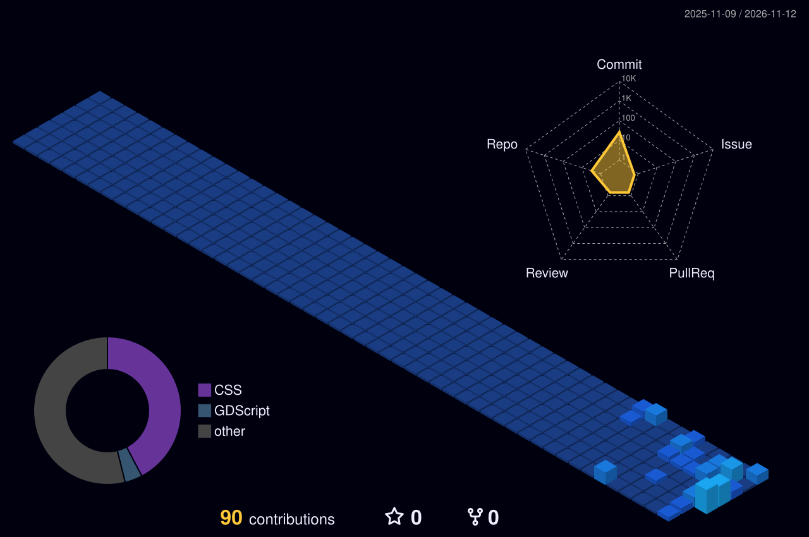

<div align="center">

```
  ____   _    ____ ___   ____ ___  ______     ______  
 |  _ \ / \  |  _ \_ _| / ___/ _ \|  _ \ \   / / __ \ 
 | |_) / _ \ | |_) | | | |  | | | | |_) \ \ / / |  | |
 |  __/ ___ \|  __/| | | |__| |_| |  _ < \ V /| |__| |
 |_| /_/   \_\_|  |___| \____\___/|_| \_\ \_/  \____/ 
```

<a href="https://git.io/typing-svg">
  
</a>

<br>

[](https://github.com/papi-corvo)
[](https://github.com/papi-corvo)
[](https://github.com/papi-corvo)

---

</div>

## 🧑‍💻 Terminal Bio

```json
{
  "developer": "papi-corvo",
  "role": "Full-Stack Engineer & AI Tooling Builder",
  "location": "Global / Remote",
  "email": "joshnervela@gmail.com",
  "status": "🛠️ Building FreeLLMAPI — local, self-hosted, multi-provider LLM suite",
  "interests": ["Privacy-First AI", "System Architecture", "Developer Experience"],
  "openFor": ["Open-Source Collaboration", "Freelance / Consulting Projects"]
}
```

---

## 🛠️ Tech Stack & Skills

<p align="center">
  <a href="https://skillicons.dev">
    
  </a>
</p>

<details>
  <summary><b>🔍 Detailed Stack Breakdown</b></summary>
  <br>

  | Category | Technologies & Tools |
  | :--- | :--- |
  | **Languages** | TypeScript, JavaScript, Python, Go, HTML5/CSS3, SQL, Bash |
  | **Backend** | Node.js, Express, FastAPI, REST APIs, GraphQL, WebSockets |
  | **Frontend** | React, Next.js, Tailwind CSS, Vite |
  | **AI / LLM** | OpenAI API, Ollama, LangChain, Custom Multi-Provider Abstractions |
  | **DevOps & Infrastructure** | Docker, Docker Compose, Nginx, GitHub Actions, Linux Administration |
  | **Databases** | PostgreSQL, Redis |
</details>

---

## 🏙️ 3D Contribution & Activity

<div align="center">

<!-- Live Dynamic Activity & Contribution Graph -->


<br><br>

<!-- 3D Contribution Skyline (generated by GitHub Action) -->
<picture>
  <source media="(prefers-color-scheme: dark)" srcset="https://raw.githubusercontent.com/papi-corvo/papi-corvo/main/profile-3d-contrib/profile-night-view.svg">
  <source media="(prefers-color-scheme: light)" srcset="https://raw.githubusercontent.com/papi-corvo/papi-corvo/main/profile-3d-contrib/profile-green-animate.svg">
  
</picture>

> ⚠️ **The 3D skyline needs a GitHub Action to run first** — it isn't a live URL. Create `.github/workflows/profile-3d.yml` in your `papi-corvo` repo with the workflow below, then trigger it once. After that it regenerates daily and the skyline shows up automatically.

</div>

---

## 📊 GitHub Analytics Cards

<div align="center">

<!-- Dynamic 3D Profile Summary Card (Instant) -->


<br><br>

<table border="0">
  <tr>
    <td width="50%" align="center">
      
    </td>
    <td width="50%" align="center">
      
    </td>
  </tr>
</table>


</div>

---

## 🚀 Featured Project

<div align="center">

### [⚡ FreeLLMAPI](https://github.com/papi-corvo/freellmapi)
*A self-hosted, multi-provider LLM stack with CLI, Desktop client, Backend server, and Docker deployment.*

```
├── 💻 CLI                ── Terminal interface for multi-provider prompt queries
├── 🖥️ Desktop Client     ── Cross-platform desktop application
├── ⚙️ Backend Server     ── Multi-provider API routing & orchestration
└── 🐳 Docker             ── One-command compose deployment
```

</div>

---

## 📬 Connect With Me

<p align="center">
  <a href="mailto:joshnervela@gmail.com">
    
  </a>
  <a href="https://github.com/papi-corvo">
    
  </a>
  <a href="https://linkedin.com/in/papi-corvo">
    
  </a>
</p>

<p align="center">
  
</p>
